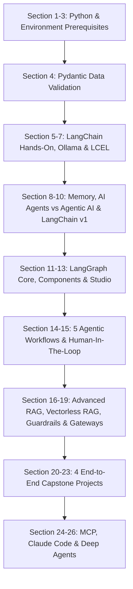

# 🗺️ Complete Agentic AI Bootcamp — Course Roadmap & Architecture

> **Course**: Complete Agentic AI Bootcamp With LangGraph and Langchain  
> **Instructor**: Krish Naik  
> **Structure**: 27 Sections | 181 Video Lectures | End-to-End Enterprise Projects  
> **Master Index**: [LECTURE_INDEX.md](./LECTURE_INDEX.md)

---

## 📌 Curriculum Overview by Udemy Sections

---

## 📑 Complete 27 Udemy Sections Directory

- **[Section 01: Introduction To the Course](./Section_01_Introduction_To_the_Course.md)** — *Lecture 1 – 1 (1 lectures)*
- **[Section 02: Installation Of Anaconda And VS Code IDE](./Section_02_Installation_Of_Anaconda_And_VS_Code_IDE.md)** — *Lecture 2 – 4 (3 lectures)*
- **[Section 03: Python Prerequisites](./Section_03_Python_Prerequisites.md)** — *Lecture 5 – 44 (40 lectures)*
- **[Section 04: Getting Started With Pydantic In Python](./Section_04_Getting_Started_With_Pydantic_In_Python.md)** — *Lecture 45 – 46 (2 lectures)*
- **[Section 05: Langchain Hands On](./Section_05_Langchain_Hands_On.md)** — *Lecture 47 – 59 (13 lectures)*
- **[Section 06: Getting Started With OpenAI And Ollama](./Section_06_Getting_Started_With_OpenAI_And_Ollama.md)** — *Lecture 60 – 65 (6 lectures)*
- **[Section 07: Building Basic LLM Application Using LCEL](./Section_07_Building_Basic_LLM_Application_Using_LCEL.md)** — *Lecture 66 – 68 (3 lectures)*
- **[Section 08: Building AI agents With Conversation History Using Langchain](./Section_08_Building_AI_agents_With_Conversation_History_Using_Langchain.md)** — *Lecture 69 – 72 (4 lectures)*
- **[Section 09: AI Agents Vs Agentic AI](./Section_09_AI_Agents_Vs_Agentic_AI.md)** — *Lecture 73 – 74 (2 lectures)*
- **[Section 10: Updated Langchain Version V1](./Section_10_Updated_Langchain_Version_V1.md)** — *Lecture 75 – 86 (12 lectures)*
- **[Section 11: Getting Started With LangGraph](./Section_11_Getting_Started_With_LangGraph.md)** — *Lecture 87 – 94 (8 lectures)*
- **[Section 12: LangGraph Components](./Section_12_LangGraph_Components.md)** — *Lecture 95 – 107 (13 lectures)*
- **[Section 13: Debugging LangGraph Application With LangSmith](./Section_13_Debugging_LangGraph_Application_With_LangSmith.md)** — *Lecture 108 – 108 (1 lectures)*
- **[Section 14: Different Workflows In LangGraph](./Section_14_Different_Workflows_In_LangGraph.md)** — *Lecture 109 – 115 (7 lectures)*
- **[Section 15: Human In The Loop In LangGraph](./Section_15_Human_In_The_Loop_In_LangGraph.md)** — *Lecture 116 – 119 (4 lectures)*
- **[Section 16: RAG  With LangGraph](./Section_16_RAG_With_LangGraph.md)** — *Lecture 120 – 126 (7 lectures)*
- **[Section 17: Vectorless RAG](./Section_17_Vectorless_RAG.md)** — *Lecture 128 – 128 (1 lectures)*
- **[Section 18: Guardrails](./Section_18_Guardrails.md)** — *Lecture 129 – 129 (1 lectures)*
- **[Section 19: LLM Gateways](./Section_19_LLM_Gateways.md)** — *Lecture 130 – 130 (1 lectures)*
- **[Section 20: End To End Agentic AI Projects With LangGraph](./Section_20_End_To_End_Agentic_AI_Projects_With_LangGraph.md)** — *Lecture 131 – 140 (10 lectures)*
- **[Section 21: End To End Agentic Chatbot With Web Search Functionality](./Section_21_End_To_End_Agentic_Chatbot_With_Web_Search_Functionality.md)** — *Lecture 141 – 144 (4 lectures)*
- **[Section 22: AI News Summarizer End To End Agentic AI Projects](./Section_22_AI_News_Summarizer_End_To_End_Agentic_AI_Projects.md)** — *Lecture 145 – 151 (7 lectures)*
- **[Section 23: End To End Blog Generation Agentic AI App](./Section_23_End_To_End_Blog_Generation_Agentic_AI_App.md)** — *Lecture 152 – 161 (10 lectures)*
- **[Section 24: Model Context Protocol](./Section_24_Model_Context_Protocol.md)** — *Lecture 162 – 167 (6 lectures)*
- **[Section 25: Claude Code](./Section_25_Claude_Code.md)** — *Lecture 169 – 175 (7 lectures)*
- **[Section 26: Building Deep Agents With Langchain](./Section_26_Building_Deep_Agents_With_Langchain.md)** — *Lecture 176 – 183 (8 lectures)*
- **[Section 27: Role Play](./Section_27_Role_Play.md)** — *Resource Section*

---
👉 [Open Master 1-to-1 Lecture Index](./LECTURE_INDEX.md)
