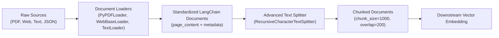
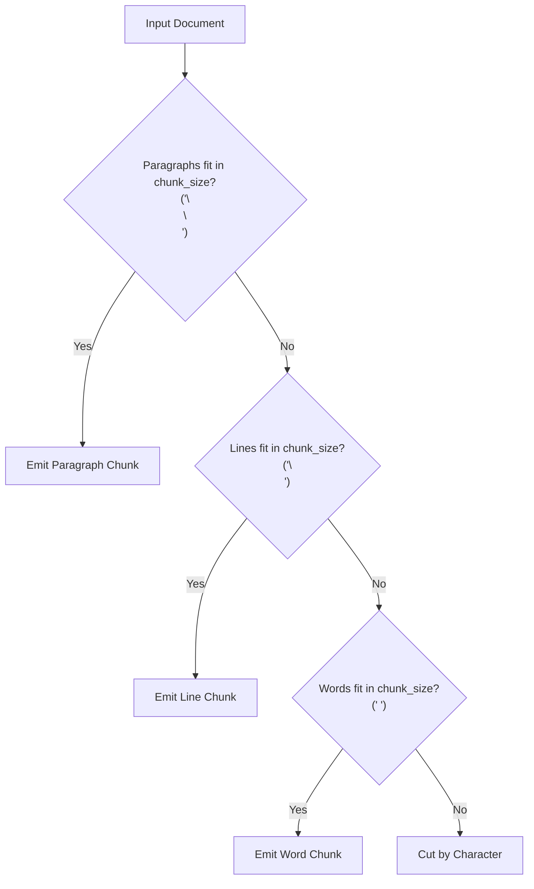
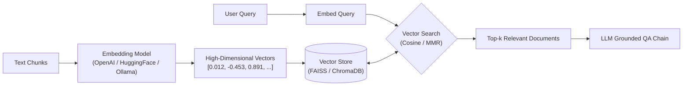
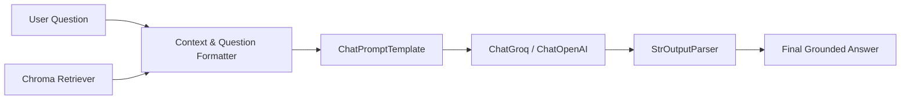

# Section 5: Langchain Hands On

> **Udemy Section 5 of 27**: Langchain Hands On  
> **Lectures Covered**: Lecture 47 to Lecture 59  
> **Instructor**: Krish Naik  
> **Master Index**: [LECTURE_INDEX.md](./LECTURE_INDEX.md) | [00_Course_Overview_and_Roadmap.md](./00_Course_Overview_and_Roadmap.md)

---

> **Lectures Covered**: Lecture 47 to Lecture 54  
> **Course Section**: Langchain Hands On — Ingestion & Chunking Architecture  
> **Instructor**: Krish Naik  
> **Prerequisites**: [08_Pydantic_and_Data_Validation.md](./08_Pydantic_and_Data_Validation.md)  
> **Master Index**: [LECTURE_INDEX.md](./LECTURE_INDEX.md) | [00_Course_Overview_and_Roadmap.md](./00_Course_Overview_and_Roadmap.md)

---

## 📌 Executive Overview & Core Problem

In enterprise RAG (Retrieval-Augmented Generation), models are only as good as the context they receive. Real-world documents arrive in messy, unstructured formats: PDFs, text files, HTML webpages, CSVs, and nested JSON payloads.

Feeding entire documents directly to an LLM fails because:
1. Context windows have hard token caps.
2. Irrelevant sections dilute semantic attention.
3. Vector similarity matching degrades exponentially on long, unfocused chunks.

To solve this, LangChain provides a two-phase data ingestion pipeline:
1. **Document Loaders**: Connectors that extract text and rich metadata (file path, author, page number) into standardized `Document` objects.
2. **Text Splitters**: Chunking strategies that divide long documents into semantically coherent fragments with sliding window overlaps to preserve context continuity.



---

## 📖 Detailed Lecture-by-Lecture Walkthrough

---

### 🔹 Lecture 47–49: LangChain Architecture & Environment Setup

#### 1. Core Primitives of LangChain
- **`Document`**: The atomic data unit in LangChain:
  ```python
  from langchain_core.documents import Document
  doc = Document(
      page_content="This is the extracted body text.",
      metadata={"source": "annual_report.pdf", "page": 4}
  )
  ```
- **Environment**: Setup using `python-dotenv` for managing API keys (`OPENAI_API_KEY`, `GROQ_API_KEY`).

---

### 🔹 Lecture 50: Data Ingestion with Document Loaders

Krish demonstrates ingesting data across three primary loaders: `TextLoader`, `PyPDFLoader`, and `WebBaseLoader`.

#### 1. `TextLoader` (Plain Text & Markdown)
```python
from langchain_community.document_loaders import TextLoader

loader = TextLoader("speech.txt", encoding="utf-8")
docs = loader.load()

print(f"Total documents loaded: {len(docs)}")
print("Metadata:", docs[0].metadata)
print("Content snippet:", docs[0].page_content[:150])
```

#### 2. `PyPDFLoader` (PDF Documents with Page-Level Metadata)
`PyPDFLoader` splits multi-page PDFs automatically, generating one `Document` per page with `page` index in metadata:

```python
from langchain_community.document_loaders import PyPDFLoader

pdf_loader = PyPDFLoader("sample_paper.pdf")
pages = pdf_loader.load()

print(f"Total pages: {len(pages)}")
print(f"Page 1 Content:\n{pages[0].page_content[:200]}")
print(f"Page 1 Metadata:\n{pages[0].metadata}") # {'source': 'sample_paper.pdf', 'page': 0}
```

#### 3. `WebBaseLoader` (Webpage Ingestion via BeautifulSoup)
```python
from langchain_community.document_loaders import WebBaseLoader
import bs4

# Ingest specific HTML tags to avoid pulling navigation menus and footers
web_loader = WebBaseLoader(
    web_paths=("https://lilianweng.github.io/posts/2023-06-23-agent/",),
    bs_kwargs=dict(
        parse_only=bs4.SoupStrainer(
            class_=("post-content", "post-title", "post-header")
        )
    ),
)
web_docs = web_loader.load()
```

---

### 🔹 Lecture 51: Recursive Character Text Splitter (The Gold Standard)

#### 1. Why Character Splitting Fails
A naive character splitter cuts text strictly every $N$ characters. If the boundary falls in the middle of a word or sentence (*"The CEO an- | nounced record profits"*), semantic meaning is severed.

#### 2. The Recursive Approach
`RecursiveCharacterTextSplitter` recursively attempts to split text using a hierarchical list of natural linguistic separators:
1. `"\n\n"` (Double newlines / Paragraphs)
2. `"\n"` (Single newlines / Lines)
3. `" "` (Spaces / Words)
4. `""` (Individual characters fallback)

It keeps paragraphs together first. Only if a paragraph exceeds `chunk_size` does it fall back to splitting by sentences, then by words.



#### 3. Implementation with Overlap
```python
from langchain_text_splitters import RecursiveCharacterTextSplitter

text_splitter = RecursiveCharacterTextSplitter(
    chunk_size=500,        # Maximum characters per chunk
    chunk_overlap=50,      # Overlapping characters between consecutive chunks
    length_function=len,   # Function to calculate length (len or token counter)
    is_separator_regex=False
)

chunks = text_splitter.split_documents(docs)
print(f"Original doc split into {len(chunks)} chunks.")
```

> 💡 **Why `chunk_overlap` is Mandatory**: If a critical fact spans the boundary of Chunk 1 and Chunk 2, overlap ensures both chunks retain the complete context, preventing retrieval gaps.

---

### 🔹 Lecture 52: Character Text Splitter

Krish demonstrates the basic `CharacterTextSplitter`, which splits strictly on a single defined delimiter (e.g., `separator="\n"`):
```python
from langchain_text_splitters import CharacterTextSplitter

basic_splitter = CharacterTextSplitter(
    separator="\n\n",
    chunk_size=1000,
    chunk_overlap=200
)
```

---

### 🔹 Lecture 53: HTML Header Text Splitter (Structure-Aware Splitting)

#### 1. The Structure Preservation Problem
When scraping web documentation or HTML pages, flat text chunking loses header context (e.g. knowing that a paragraph belongs to `<h2>Installation</h2> -> <h3>Docker</h3>`).

#### 2. Splitting by HTML Semantic Tags
`HTMLHeaderTextSplitter` parses HTML tags and automatically injects the parent header hierarchy into the chunk's `metadata`:

```python
from langchain_text_splitters import HTMLHeaderTextSplitter

html_string = """
<!DOCTYPE html>
<html>
<body>
    <h1>LangChain Handbook</h1>
    <h2>Introduction</h2>
    <p>LangChain is a framework for developing LLM apps.</p>
    <h2>Installation</h2>
    <h3>Using Pip</h3>
    <p>Run pip install langchain in terminal.</p>
</body>
</html>
"""

headers_to_split_on = [
    ("h1", "Header 1"),
    ("h2", "Header 2"),
    ("h3", "Header 3"),
]

html_splitter = HTMLHeaderTextSplitter(headers_to_split_on=headers_to_split_on)
html_header_splits = html_splitter.split_text(html_string)

for split in html_header_splits:
    print("Content:", split.page_content)
    print("Metadata:", split.metadata)
    print("---")

# Output Metadata:
# {'Header 1': 'LangChain Handbook', 'Header 2': 'Installation', 'Header 3': 'Using Pip'}
```

---

### 🔹 Lecture 54: Recursive JSON Text Splitter

#### 1. Ingesting Complex APIs & Nested JSON
When working with JSON logs, database dumps, or REST payloads, standard text splitters mangle JSON syntax, breaking brackets and quotes.

`RecursiveJsonSplitter` recursively navigates nested JSON dictionaries and lists, ensuring JSON structure and key-value pairs remain syntactically valid within `max_chunk_size`:

```python
from langchain_text_splitters import RecursiveJsonSplitter
import json

json_data = {
    "company": "TechCorp",
    "employees": [
        {"id": 1, "name": "Alice", "role": "AI Architect", "projects": ["RAG", "Agents"]},
        {"id": 2, "name": "Bob", "role": "DevOps Lead", "projects": ["Kubernetes", "CI/CD"]},
        {"id": 3, "name": "Charlie", "role": "Data Engineer", "projects": ["Kafka", "Spark"]}
    ]
}

json_splitter = RecursiveJsonSplitter(max_chunk_size=150)
json_chunks = json_splitter.split_json(json_data=json_data)

for c in json_chunks:
    print(c)
```

---

## 💡 Production Best Practices & Architectural Takeaways

1. **Rule of Thumb for `chunk_size` and `chunk_overlap`**:
   - For factual QA & dense technical documentation: `chunk_size=500–800`, `chunk_overlap=100–150`.
   - For broad summarization: `chunk_size=1500–2000`, `chunk_overlap=200–300`.
   - Always maintain `chunk_overlap` at roughly **10% to 20%** of `chunk_size`.
2. **Metadata Filtering is Your Superpower**:
   Never discard metadata during ingestion. Storing `file_name`, `page_number`, `created_at`, or `department` allows downstream vectorstores to execute **Metadata Pre-Filtering** (`filter={"department": "legal"}`), reducing search spaces by 90%.

---

## ❓ Interview & Conceptual Questions

### Q1: Why is `RecursiveCharacterTextSplitter` preferred over standard `CharacterTextSplitter` in RAG?
> **Answer**: `CharacterTextSplitter` splits strictly on a single delimiter. If that delimiter isn't found within `chunk_size`, it forces arbitrary cuts. `RecursiveCharacterTextSplitter` uses a hierarchical priority list of separators (`\n\n`, `\n`, space), keeping paragraphs and sentences intact wherever possible, thereby maximizing semantic coherence.

### Q2: What problem does `HTMLHeaderTextSplitter` solve for web documentation?
> **Answer**: Standard text splitters strip HTML tags and treat the document as a flat stream of text, losing the hierarchical relationship between sections. `HTMLHeaderTextSplitter` parses headings (`h1`, `h2`, `h3`) and attaches the active header path directly into each chunk's `metadata`, allowing LLMs to know exactly which section a fragment came from.

---

👉 [Back to Master Lecture Index](./LECTURE_INDEX.md) | [Back to Master Roadmap](./00_Course_Overview_and_Roadmap.md)


---


> **Lectures Covered**: Lecture 55 to Lecture 62  
> **Course Section**: Embeddings, Vector Stores & RAG Retrieval Chains  
> **Instructor**: Krish Naik  
> **Prerequisites**: [09_Document_Loaders_and_Text_Splitters.md](./09_Document_Loaders_and_Text_Splitters.md)  
> **Master Index**: [LECTURE_INDEX.md](./LECTURE_INDEX.md) | [00_Course_Overview_and_Roadmap.md](./00_Course_Overview_and_Roadmap.md)

---

## 📌 Executive Overview & Core Problem

Computers cannot calculate mathematical similarity between raw strings of text. To enable semantic search (finding documents that share the *same meaning* even when using completely different keywords), text must be projected into high-dimensional geometric coordinate spaces called **Vector Embeddings**.

In this comprehensive module, Krish Naik covers:
1. **Embedding Models**: Comparing cloud-hosted (OpenAI) vs local private embeddings (Ollama, HuggingFace).
2. **Vector Stores**:
   - **FAISS**: Facebook AI Similarity Search for blazingly fast in-memory indexing.
   - **ChromaDB**: Serverless, file-backed vector database with rich metadata querying.
3. **Retrievers & Search Algorithms**:
   - Standard Cosine Similarity ($k$-Nearest Neighbors).
   - **Maximal Marginal Relevance (MMR)**: Balancing relevance with diversity to avoid redundant chunks.
4. **End-to-End RAG Chains**: Connecting Vectorstores directly to LLMs via LCEL.



---

## 📖 Detailed Lecture-by-Lecture Walkthrough

---

### 🔹 Lecture 55–57: Embedding Models (OpenAI vs Ollama vs HuggingFace)

#### 1. What is an Embedding?
An embedding model converts text into a fixed-length array of floating-point numbers ($d$-dimensional vector) where semantically similar phrases are located close together in hyperspace (high cosine similarity).

$$\text{Cosine Similarity} = \frac{\mathbf{A} \cdot \mathbf{B}}{\|\mathbf{A}\| \|\mathbf{B}\|}$$

#### 2. Provider Comparison

| Provider | Model Name | Dimensions | Host Location | Cost | Best For |
| :--- | :--- | :--- | :--- | :--- | :--- |
| **OpenAI** | `text-embedding-3-small` | 1536 | Cloud API | Cheap ($0.02 / 1M tokens) | High quality, cloud production. |
| **OpenAI** | `text-embedding-3-large` | 3072 | Cloud API | Moderate ($0.13 / 1M) | Complex enterprise retrieval. |
| **HuggingFace** | `all-MiniLM-L6-v2` | 384 | Local CPU/GPU | **$0.00 (Free)** | Zero cost, fast prototyping. |
| **Ollama** | `nomic-embed-text` | 768 | Local Daemon | **$0.00 (Free)** | Local privacy, high accuracy. |

#### 3. Hands-on Code: Comparing the 3 Embeddings

```python
import os
from dotenv import load_dotenv

load_dotenv()

# 1. OpenAI Embeddings
from langchain_openai import OpenAIEmbeddings
openai_embed = OpenAIEmbeddings(model="text-embedding-3-small")
v1 = openai_embed.embed_query("Machine learning is transforming software.")
print("OpenAI Vector Length:", len(v1)) # 1536

# 2. HuggingFace Embeddings (Local sentence-transformers)
from langchain_community.embeddings import HuggingFaceEmbeddings
hf_embed = HuggingFaceEmbeddings(model_name="all-MiniLM-L6-v2")
v2 = hf_embed.embed_query("Machine learning is transforming software.")
print("HuggingFace Vector Length:", len(v2)) # 384

# 3. Ollama Embeddings (Local Ollama Daemon)
from langchain_ollama import OllamaEmbeddings
ollama_embed = OllamaEmbeddings(model="nomic-embed-text")
v3 = ollama_embed.embed_query("Machine learning is transforming software.")
print("Ollama Vector Length:", len(v3)) # 768
```

---

### 🔹 Lecture 58: Vector Stores — FAISS (Facebook AI Similarity Search)

#### 1. What is FAISS?
Developed by Meta AI Research, FAISS is an industry-standard C++ library (with Python bindings) optimized for efficient similarity search and clustering of dense vectors on billion-scale datasets.

#### 2. Building, Saving & Loading a FAISS Vectorstore

```python
from langchain_community.document_loaders import TextLoader
from langchain_text_splitters import CharacterTextSplitter
from langchain_community.vectorstores import FAISS

# Ingest and chunk
loader = TextLoader("speech.txt", encoding="utf-8")
documents = loader.load()
text_splitter = CharacterTextSplitter(chunk_size=500, chunk_overlap=50)
docs = text_splitter.split_documents(documents)

# 1. Create In-Memory FAISS Index from Documents
faiss_db = FAISS.from_documents(docs, openai_embed)

# 2. Similarity Search
query = "What is the primary message regarding freedom?"
results = faiss_db.similarity_search(query, k=2)

for i, doc in enumerate(results):
    print(f"\nResult {i+1}:")
    print(doc.page_content[:150])

# 3. Save FAISS Index to Local Disk
faiss_db.save_local("faiss_index_store")
print("\nFAISS Index saved to faiss_index_store/")

# 4. Reload from Disk Later
reloaded_db = FAISS.load_local(
    "faiss_index_store", 
    openai_embed, 
    allow_dangerous_deserialization=True
)
```

---

### 🔹 Lecture 59: Vector Stores — ChromaDB

#### 1. What is ChromaDB?
Chroma is an open-source, AI-native embedding database designed specifically for LLM app developers. Unlike FAISS (which is purely an algorithmic index), Chroma provides a complete database engine with SQLite persistence, collection management, and rich metadata filtering.

#### 2. ChromaDB Implementation with Persistence

```python
from langchain_community.vectorstores import Chroma

# 1. Initialize persistent ChromaDB
persist_directory = "./chroma_db_store"

chroma_db = Chroma.from_documents(
    documents=docs,
    embedding=openai_embed,
    persist_directory=persist_directory,
    collection_name="company_knowledge_base"
)

# 2. Similarity Search with Score (Lower distance = higher similarity)
query = "Explain our customer return policy"
results_with_score = chroma_db.similarity_search_with_score(query, k=2)

for doc, score in results_with_score:
    print(f"Score (Distance): {score:.4f} | Content: {doc.page_content[:100]}...")

# 3. Metadata Filtering Query
filtered_results = chroma_db.similarity_search(
    query="refund terms",
    k=2,
    filter={"source": "speech.txt"} # Filter strictly by metadata
)
```

---

### 🔹 Lecture 60: Understanding Retrievers & Search Algorithms (MMR)

#### 1. Converting Vectorstores into Retrievers
In LangChain, a `Retriever` is a `Runnable` that takes a string query and returns a list of `Document`s.

```python
retriever = chroma_db.as_retriever(
    search_type="similarity",
    search_kwargs={"k": 3}
)
```

#### 2. Maximal Marginal Relevance (MMR)
- **The Problem with Standard Cosine Search**: If the top 3 chunks are near-duplicates from the same paragraph, the LLM receives redundant context while missing other perspectives.
- **MMR Solution**: MMR selects chunks that are **relevant to the query** while simultaneously maximizing **diversity** relative to already selected chunks.

$$\text{MMR} = \arg\max_{D_i \in R \setminus S} \left[ \lambda \, \text{Sim}_1(D_i, Q) - (1 - \lambda) \max_{D_j \in S} \text{Sim}_2(D_i, D_j) \right]$$

```python
# Enable MMR Retriever
mmr_retriever = chroma_db.as_retriever(
    search_type="mmr",
    search_kwargs={
        "k": 3,           # Number of final documents to return
        "fetch_k": 20,    # Number of candidate documents to pass to MMR algorithm
        "lambda_mult": 0.5 # Diversity vs relevance tradeoff (0 = max diversity, 1 = max relevance)
    }
)
```

---

### 🔹 Lecture 61 & 62: Building End-to-End RAG Chains with LCEL

Krish concludes by assembling the complete components into a production LCEL RAG chain:



```python
from langchain_groq import ChatGroq
from langchain_core.prompts import ChatPromptTemplate
from langchain_core.output_parsers import StrOutputParser
from langchain_core.runnables import RunnablePassthrough

# 1. Initialize LLM
llm = ChatGroq(model="llama-3.3-70b-versatile", temperature=0)

# 2. Prompt Template
prompt_template = """
Answer the question based ONLY on the provided context below.
If you do not know the answer, say "I cannot find the answer in the provided context."

Context:
{context}

Question:
{question}

Helpful Answer:
"""
prompt = ChatPromptTemplate.from_template(prompt_template)

# 3. Helper to format list of docs into single string
def format_docs(docs):
    return "\n\n".join(doc.page_content for doc in docs)

# 4. Construct LCEL RAG Chain
rag_chain = (
    {"context": retriever | format_docs, "question": RunnablePassthrough()}
    | prompt
    | llm
    | StrOutputParser()
)

# 5. Execute RAG Query
answer = rag_chain.invoke("What are the key principles discussed in the speech?")
print("\n--- RAG Generated Answer ---")
print(answer)
```

---

## 💡 Production Best Practices & Architectural Takeaways

1. **Dimensionality Matching**:
   Never attempt to query a vectorstore indexed with 1536-dim embeddings using a 384-dim embedding model. They must match identically.
2. **Always Use MMR for Research & Complex Documents**:
   When indexing legal briefs, financial reports, or academic papers, standard top-$k$ cosine search frequently returns 3 almost identical paragraphs. Setting `search_type="mmr"` dramatically enriches the context window with varied information.
3. **Persist Your Indices**:
   FAISS and Chroma indices should be computed during an offline batch ETL job, saved to disk or object storage (S3/GCS), and loaded at application startup rather than re-embedding documents on every restart.

---

## ❓ Interview & Conceptual Questions

### Q1: What is the core difference between FAISS and ChromaDB?
> **Answer**: FAISS is a low-level, high-performance C++ similarity search library optimized purely for vector matrix multiplication in RAM or GPU. ChromaDB is a full-featured, AI-native vector database with persistent storage, ACID guarantees, collection metadata indexing, and query filtering out of the box.

### Q2: What is Maximal Marginal Relevance (MMR) and why is it vital in RAG systems?
> **Answer**: Standard cosine similarity search picks the $k$ closest vectors, which often leads to redundant chunks repeating the same sentences. MMR optimizes for both relevance to the user's question and diversity among the chosen documents, penalizing candidate chunks that are too similar to already selected chunks.

---

👉 [Back to Master Lecture Index](./LECTURE_INDEX.md) | [Back to Master Roadmap](./00_Course_Overview_and_Roadmap.md)

---
👉 [Back to Master Lecture Index](./LECTURE_INDEX.md) | [Back to Master Roadmap](./00_Course_Overview_and_Roadmap.md)
