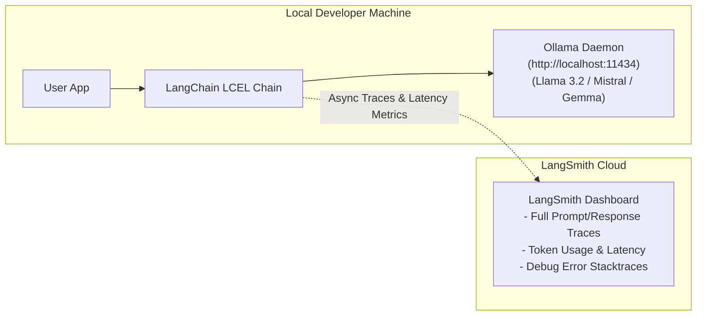

# Section 6: Getting Started With OpenAI And Ollama

> **Udemy Section 6 of 27**: Getting Started With OpenAI And Ollama  
> **Lectures Covered**: Lecture 60 to Lecture 65  
> **Instructor**: Krish Naik  
> **Master Index**: [README.md](./README.md) | [00_Course_Overview_and_Roadmap.md](./00_Course_Overview_and_Roadmap.md)

---

> **Lectures Covered**: Lecture 63 to Lecture 65  
> **Course Section**: Getting Started With OpenAI And Ollama | Local Ollama LLMs & LangSmith Tracing  
> **Instructor**: Krish Naik  
> **Prerequisites**: [09_Document_Loaders_and_Text_Splitters.md](./09_Document_Loaders_and_Text_Splitters.md), [10_Embeddings_and_Vector_Stores.md](./10_Embeddings_and_Vector_Stores.md)  
> **Master Index**: [README.md](./README.md) | [00_Course_Overview_and_Roadmap.md](./00_Course_Overview_and_Roadmap.md)

---

## 📌 Executive Overview & Core Problem

When building enterprise generative AI systems, developers encounter two major operational hurdles:
1. **Data Privacy & Cost Optimization**: Sending proprietary corporate data or sensitive PII to external proprietary APIs (like OpenAI or Anthropic) introduces compliance violations and ballooning API costs. Running **local quantized open-source models** on private infrastructure solves this completely.
2. **Production Black-Box Problem (Observability)**: When an LLM application behaves unpredictably, hallucinates, or times out, developers need granular visibility into every prompt template formatting, token latency, and intermediate chain step.

In this module, Krish Naik demonstrates:
- How to run local models on consumer hardware using **Ollama**.
- How to interface with local models via **LangChain** (`ChatOllama`).
- How to set up continuous tracing and performance monitoring with **LangSmith**.



---

## 📖 Detailed Lecture-by-Lecture Walkthrough

---

### 🔹 Lecture 63: Introduction To Ollama & Setup

#### 1. What is Ollama?
Ollama is a lightweight, cross-platform framework designed to run, customize, and manage open-source large language models locally. Under the hood, it bundles **llama.cpp** to execute quantized GGUF weights directly on modern CPUs and Apple Silicon/NVIDIA GPUs.

#### 2. Installing Ollama & Core CLI Commands
Download the installer from [ollama.ai](https://ollama.ai) (available for macOS, Linux, and Windows).

```bash
# Verify installation
ollama --version

# Pull and run a lightweight model (e.g., Llama 3.2 3B or Gemma 2 2B)
ollama run llama3.2

# List all locally downloaded models
ollama list

# Stop or remove models
ollama rm llama3.2
```

By default, Ollama spins up a background daemon listening at:
`http://localhost:11434`

---

### 🔹 Lecture 64: Building a GenAI Application using Ollama & LangChain

#### 1. Installing LangChain Ollama Integration
```bash
pip install langchain-ollama langchain-core python-dotenv
```

#### 2. Implementation: LCEL Chain with `ChatOllama`

```python
import os
from dotenv import load_dotenv
from langchain_ollama import ChatOllama
from langchain_core.prompts import ChatPromptTemplate
from langchain_core.output_parsers import StrOutputParser

load_dotenv()

# 1. Initialize Local Model via ChatOllama
# base_url defaults to "http://localhost:11434"
llm = ChatOllama(
    model="llama3.2",
    temperature=0.4
)

# 2. Define LCEL Prompt & Parser
prompt = ChatPromptTemplate.from_messages([
    ("system", "You are an expert Data Science and Agentic AI mentor."),
    ("human", "Explain the difference between a Vector Index and a Knowledge Graph in 3 concise bullet points.")
])

parser = StrOutputParser()

# 3. Assemble LCEL Chain
chain = prompt | llm | parser

# 4. Invoke locally (Zero API cost, 100% private)
response = chain.invoke({})
print("Ollama Local Response:")
print(response)
```

---

### 🔹 Lecture 65: Tracking GenAI Applications with LangSmith

#### 1. What is LangSmith?
LangSmith is the enterprise platform developed by LangChain for debugging, testing, evaluating, and monitoring LLM applications. It provides end-to-end distributed tracing across all LCEL chains, agents, and tool calls.

#### 2. Configuration & Environment Variables
Sign up at [smith.langchain.com](https://smith.langchain.com) and generate an API key. Then configure the 4 standard LangSmith environment variables:

```env
# Enable LangSmith tracing (True/False)
LANGCHAIN_TRACING_V2=true

# LangSmith endpoint URL
LANGCHAIN_ENDPOINT=https://api.smith.langchain.com

# Your LangSmith API Key
LANGCHAIN_API_KEY=lsv2_pt_...

# The project namespace under which traces will be organized
LANGCHAIN_PROJECT=Udemy-Agentic-AI-Bootcamp
```

#### 3. Automatic Zero-Code Tracing
Once those 4 environment variables are set in `.env` and loaded via `load_dotenv()`, **every single LangChain / LangGraph execution is automatically captured and streamed to LangSmith** without modifying a single line of your application code!

```python
import os
from dotenv import load_dotenv
from langchain_ollama import ChatOllama
from langchain_core.prompts import ChatPromptTemplate
from langchain_core.output_parsers import StrOutputParser

load_dotenv()

# Any chain invoked here will now appear in your LangSmith dashboard!
llm = ChatOllama(model="llama3.2", temperature=0)
prompt = ChatPromptTemplate.from_template("What are the advantages of local LLMs for healthcare?")
chain = prompt | llm | StrOutputParser()

res = chain.invoke({})
print(res)
```

#### 4. What LangSmith Traces Display:
1. **Run Tree**: Hierarchical view showing `RunnableSequence -> ChatPromptTemplate -> ChatOllama -> StrOutputParser`.
2. **Exact Inputs & Outputs**: The exact rendered prompt string sent to the model and the raw model completion.
3. **Latency**: Exact millisecond execution time per component (e.g. Prompt formatting: 1.2ms, Ollama inference: 1,420ms).
4. **Token Counts & Error Logs**: Immediate visibility into stack traces and timeout exceptions.

---

## 💡 Production Best Practices & Architectural Takeaways

1. **Quantization Selection in Ollama**:
   - For 8GB RAM laptops: Use `llama3.2:1b` or `llama3.2:3b`.
   - For 16GB RAM / M-series Mac: Use `llama3.1:8b` or `mistral:7b`.
   - For 32GB+ RAM: Use `mixtral:8x7b` or `qwen2.5:14b`.
2. **Never Commit LangSmith Keys to Git**:
   Always place `LANGCHAIN_API_KEY` inside `.env` and ensure `.env` is listed in `.gitignore`.
3. **Use Project Namespaces**:
   Always set distinct `LANGCHAIN_PROJECT` names for `dev`, `staging`, and `production` environments to keep test traces isolated from user traffic.

---

## ❓ Interview & Conceptual Questions

### Q1: What are the primary business and technical advantages of running models via Ollama versus cloud APIs?
> **Answer**:
> 1. **Data Sovereignty & Privacy**: Data never leaves the local network, satisfying GDPR, HIPAA, and corporate compliance.
> 2. **Zero Ingestion Costs**: Unlimited inference without per-token API charges.
> 3. **Offline Capability**: Edge devices and air-gapped environments can execute inference without internet connectivity.

### Q2: How does LangSmith capture execution traces without wrapping functions manually?
> **Answer**: LangSmith hooks into LangChain's internal `CallbackManager` architecture. Every `Runnable` in LCEL automatically passes execution lifecycle events (`on_chain_start`, `on_llm_start`, `on_llm_end`, `on_chain_error`) to registered background tracer threads that upload structured telemetry to LangSmith asynchronously.

---

👉 [Back to Master Lecture Index](./README.md) | [Back to Master Roadmap](./00_Course_Overview_and_Roadmap.md)

---
👉 [Back to Master Lecture Index](./README.md) | [Back to Master Roadmap](./00_Course_Overview_and_Roadmap.md)
